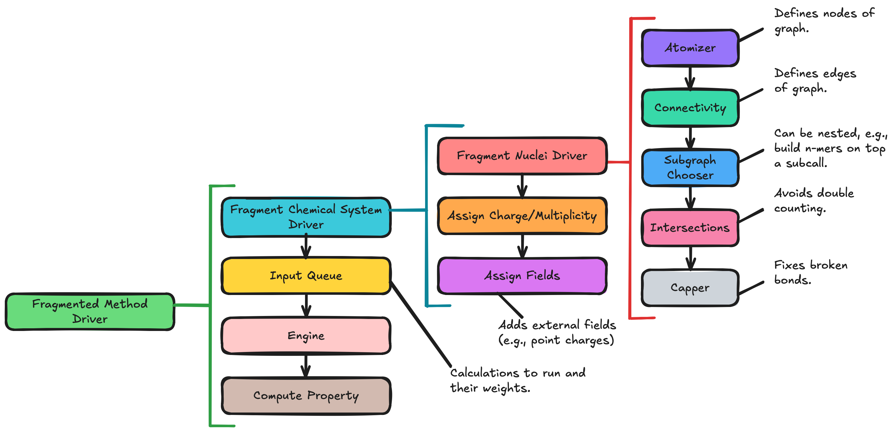

.. Copyright 2025 GhostFragment
..
.. Licensed under the Apache License, Version 2.0 (the "License");
.. you may not use this file except in compliance with the License.
.. You may obtain a copy of the License at
..
.. http://www.apache.org/licenses/LICENSE-2.0
..
.. Unless required by applicable law or agreed to in writing, software
.. distributed under the License is distributed on an "AS IS" BASIS,
.. WITHOUT WARRANTIES OR CONDITIONS OF ANY KIND, either express or implied.
.. See the License for the specific language governing permissions and
.. limitations under the License.

.. _gf_architecture:

##########################
GhostFragment Architecture
##########################

The current architecture of GhostFragment is shown in :numref:`fig_gf_arch`.

.. _fig_gf_arch:

   GhostFragment is designed as a series of nested drivers.

*************************
Fragmented Method  Driver
*************************

Full design details are at: :ref:`gf_fragmented_method_driver_design`.

********************************
Fragmented ChemicalSystem Driver
********************************

************************
Fragmented Nuclei Driver
************************

Full design details are at: :ref:`gf_fragmented_nuclei_driver_design`.